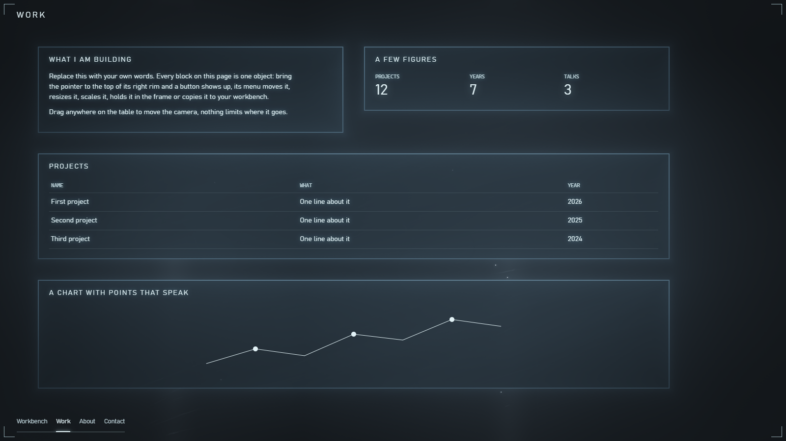

# Rostrum

Rostrum turns a web page into a table seen through a camera. Every block of the page is an object on that table. A visitor can move it, resize it, scale it or copy it to another tab, and the browser remembers where everything was left. The table itself is drawn with WebGL and lit by the objects lying on it.

The name comes from the rostrum camera, a film camera mounted on a stand above a table that moves over the flat work lying under it.

It has no dependencies and no build step. The files in this repository are what the browser runs.



## Try it

Browsers do not load JavaScript modules from `file://`, so serve the folder with any static server and open `http://localhost:8090/demo/`.

```bash
python -m http.server 8090
```

## What a visitor can do

- Move the camera by dragging anywhere on the table, with the wheel, or with the arrow keys and PageUp and PageDown. Ctrl and the wheel change its height around the pointer.
- Bring the pointer to the top of an object's right edge. A button shows up and opens the menu of that object: move, change size, hold in the frame, scale, copy to the workbench, reset.
- Put an object anywhere, at any size, over other objects too. Its neighbours stay where they are. When it reaches past the cell of its tab, the next tabs move away to make room.
- Walk to another tab by moving the camera there, since all tabs lie on one table. A tab shows when the camera comes near and opens when the middle of the frame stands on it. A press on the rail flies to the tab over the same table.
- Take snapshots of an arrangement in the settings menu, go back to any of them, or return to the standard one. Each tab keeps its own.
- Collect objects on the workbench, a tab that starts empty. A copy has its own place and size and keeps updating.
- Use a phone or a tablet. Below 768 px the page becomes one column. A finger scrolls with inertia, a sideways swipe goes to the next tab, two fingers change the height of the camera, and a tap brings up the button of the object's menu.

Objects draw themselves when first seen, the outline in light, then the forms from largest to smallest, then the words from the largest type. A later update changes only what differs. When a menu or a tip opens, the camera pulls focus to its words and blurs what lies closest to them, so they need no background.

## Quick start

Copy these files into a `rostrum` folder next to your page. Each `rostrum-object` is one object.

```html
<!doctype html>
<html lang="en" data-rostrum>
<head>
  <meta charset="utf-8">
  <meta name="viewport" content="width=device-width, initial-scale=1">
  <title>My site</title>
  <link rel="stylesheet" href="rostrum/rostrum.css">
  <link rel="stylesheet" href="rostrum/elements.css">
</head>
<body>
  <rostrum-table storage="my-site." workbench="bench" workbench-title="Workbench">
    <rostrum-tab name="work" title="Work">
      <rostrum-object name="about" cols="1"><h3>About</h3><p>Anything goes inside.</p></rostrum-object>
      <rostrum-object name="numbers" cols="1">
        <div data-rostrum-reading><div data-label>Projects</div><div data-value>12</div></div>
      </rostrum-object>
      <rostrum-object name="projects" lane="1"><h3>Projects</h3></rostrum-object>
    </rostrum-tab>
    <rostrum-tab name="contact" title="Contact">
      <rostrum-object name="reach"><h3>Contact</h3></rostrum-object>
    </rostrum-tab>
  </rostrum-table>
  <script type="module" src="rostrum/elements.js"></script>
</body>
</html>
```

`elements.css` styles the title and the rail that `rostrum-table` adds to the page. What an object shows inside is up to your own CSS, see `demo/index.html` for an example.

| Attribute | On | Meaning |
| --- | --- | --- |
| `storage` | `rostrum-table` | prefix in browser storage, by default it comes from the path of the page |
| `workbench`, `workbench-title` | `rostrum-table` | name and title of the workbench tab, leave them out for no workbench |
| `start` | `rostrum-table` | the tab to open first |
| `options` | `rostrum-table` | any setting from [Options](#options) that fits in JSON, for example `options='{"strings":{"move":"Move it"}}'` |
| `name`, `title` | `rostrum-tab` | name of the tab on the table and on the rail |
| `place` | `rostrum-tab` | where the tab lies as `column,row`, for example `place="1,0"`. A tab without it takes the next free place in the first row |
| `name` | `rostrum-object` | stable name, the arrangement is remembered under it |
| `cols` | `rostrum-object` | width in the standard arrangement, 1 or 2 columns, 2 by default |
| `lane` | `rostrum-object` | 0 or 1, the lane in the standard arrangement. A lane is two columns wide |

Inside an object, `data-rostrum-reading` with `data-label` and `data-value` makes a figure that runs through digits when it changes. A `<title>` in an SVG shape becomes a label written on the table.

The element holds the running engine in its `rostrum` property. It also fires `rostrum-ready` with the engine in `detail` as soon as `elements.js` loads, so a listener has to be added before that script.

## From code

`createRostrum` from `index.js` takes over a page you already have. It needs to know what an object is and never looks at what objects show.

```js
import {createRostrum} from './rostrum/index.js';

const rostrum = createRostrum({
  frame: document.querySelector('main'),
  plane: document.querySelector('main .content'),   // one <section id="t-NAME"> per tab
  tabs: ['bench', 'overview', 'details'],           // the workbench gets its section from the engine
  start: 'overview',
  workbench: 'bench',
  storage: 'my-site.',
  rail: document.querySelector('nav'),              // buttons with data-tab
  surfaces: section => [...section.querySelectorAll('.card')],
  ownKey: card => card.id,
  redraw: tab => drawCharts(tab),
});
```

Link `rostrum.css` on such a page. `elements.css` is not needed, the title and the rail are yours to style.

### The engine object

Everything not listed here may change between versions.

| Name | What it does |
| --- | --- |
| `open(tab, apply, {walked})` | opens a tab. `apply` runs when the tab comes to the front. `walked` says the camera is already there and nothing has to fly |
| `tab`, `flight` | the open tab, the flight on its way or `null` |
| `goHome()` | takes the camera back to the start of the open tab |
| `collect()` | call it after the page added or removed objects |
| `settleSoon()` | has objects follow a change of size at the pace of the camera |
| `isLive(tab)` | true while a tab is open, in the frame or lending objects to the workbench. Keep live updates running only for such tabs |
| `whenCalm()` | a promise for the moment the camera comes to rest. Rendering takes long tasks and they show as jerks on the move |
| `turn()` | a promise for the turn of whatever renders into a tab. It comes at once at rest and between camera frames on the move |
| `later(key, work)` | one piece of drawing in its turn. New work for a key replaces work still waiting under it |
| `holdDrawing(tab, loaded)` | keeps the objects of a tab unseen, outlines included, until the promise `loaded` settles or 6 s after the camera rests, so nothing moves once it is seen. Give the promise from `apply`, let the fetch run during the flight and lay out the answer after `whenCalm()` |
| `writeIn(element)` | words a site just changed in place write themselves in |
| `updating(tabOrElements, loaded)` | use it when a person asks for data again. Objects stand a step back with a point of light running around their edges until the promise settles, then one pass of light goes down them. Do not call it for automatic refreshes |
| `pointAt(element)` | puts a short light under an element so it can be found again |
| `headroom()` | how much the frame covers at its top |
| `listen(target, type, handler, options)` | adds an event listener that `destroy()` removes |
| `objectOf(element)` | the object of an element. Its `moveTo(x, y)`, `setSize(w, h)`, `setScale(z)`, `togglePin()` and `reset()` are remembered and laid out as a whole, `zoom` reads the scale |
| `camera.moveTo(x, y, height)` | moves the camera. `goalX`, `goalY`, `left` and `scale` can be read |
| `workbench.list`, `workbench.tabs` | what lies on the workbench and where it came from |
| `destroy()` | stops the engine and puts the page back |

The frame dispatches `rostrum:tab` when another tab opens, `rostrum:arranged` when an arrangement changes and `rostrum:away` when a tab next to the open one goes out of view.

### Options

`frame`, `plane` and `tabs` are required. The types are in `RostrumOptions` and `FxOptions` in `index.js`.

| Option | Meaning |
| --- | --- |
| `frame` | the element that becomes the frame of the camera |
| `plane` | the element with one child per tab, each with the id `t-NAME` |
| `tabs` | names of the tabs, the workbench included |
| `start` | the first tab |
| `storage` | prefix in browser storage |
| `place` | where tabs lie, as `{name: [column, row]}` |
| `rail` | the element holding the tab buttons, each with `data-tab`. The engine takes their clicks and gives the open one the class `active` |
| `navigate(tab, how)` | called when the rail, the map or the camera asks for a tab. Hand `how` on to `open`. By default it opens the tab |
| `redraw(tab)` | a size changed, an arrangement was replaced or a tab came into view for the first time, so what is drawn should be drawn again. It must work for tabs that are not open. A returned promise holds the first drawing of a tab coming into view |
| `afterLayout(section, rostrum)` | called after the objects of a tab took their places |
| `surfaces(section)` | what counts as an object in a tab. By default the visible children of the tab |
| `plan(tab, items)` | the standard place of objects as `[{el, lane, span}]`. By default from `data-rostrum-lane` and `data-rostrum-span` |
| `ownKey(el)` | the stable name of an object, by default `data-rostrum-name` or the id. An element without a name gets no menu |
| `sectionTag` | the element a tab is made of, `section` by default |
| `left`, `top`, `bottom`, `gap` | where objects start in the frame, what stays free at the bottom, the space between objects |
| `dock`, `dockTop` | a selector for the instrument of a tab, which goes along when the camera moves down the tab until its menu says otherwise, and where it stands then |
| `head`, `compactTop` | the head that stays over a narrow screen, and where objects start when there is none |
| `compactWidth` | below this width the page is one column, 768 by default |
| `unit` | limits of the width of a column as `{min, max, margin}`, by default 470, 620 and 30 |
| `tint(el)` | the light of an object as `{color, strength, edge}`. `edge` lights it from its left edge |
| `accents` | a selector for what inside objects gives its own light |
| `workbench` | the name of the workbench tab |
| `objectActions` | more rows in the menu of an object, as `[{id, label, when, run}]` |
| `limit(x, y, rostrum)` | where the camera may go, returns `{x, y}`. By default it goes anywhere |
| `scene` | `false` leaves the background to the site, the rest works without the table |
| `material` | colour of the lamps and of the table, as `{lamp, albedo}` |
| `chrome` | `{viewfinder, lens, maps, settings}`, `false` takes a part of the frame away |
| `tableMap` | the element for the map of the table, by default it is added to the page |
| `looks`, `currentLook`, `chooseLook` | looks offered in the settings menu of a site that has more than one |
| `switches` | more switches in the settings menu, as `[{id, label, get, set}]` |
| `fx` | selectors for what is a heading (`heads`), a figure (`reading: {cell, value, label}`), a picture that is not a chart (`chartSkip`), a popup (`popups`, `focusPopups`, `listPopups`, `longPopups`) and a tip (`tipClass`) |
| `strings` | the words of the menus, see `STRINGS` in `index.js` for the keys |
| `titleOf(tab)` | the name of a tab in the map |
| `report(name, error)` | where errors go, by default the console |
| `deliverBlackBox(last)` | receives the last events of a session that ended without closing. Without this option nothing is recorded |
| `wheelIgnore`, `handIgnore` | selectors for where the wheel and a press are left to the page |

### Attributes a page can set

| Attribute | Meaning |
| --- | --- |
| `data-rostrum-hands-off` | pointer and keys stay with the site here, for a map, a canvas you draw on or a slider |
| `data-rostrum-popup` | marks your own popup. The camera pulls focus to it and its words write themselves out |
| `data-rostrum-sharp` | on such a popup, a selector looked up in the popup's parent for what must stay readable while it is open |
| `data-rostrum-about="x y width height"` | on a tip, what it speaks about in shares of the tip's parent. The tip stands beside that and keeps it sharp. Without it the tip follows the pointer |

An element on the workbench has `data-rostrum-key="TAB|NAME"`, so a site can style it by tab.

A tip kept inside an object stays hidden there and its words show in the one tip of the engine. A host element present when the engine starts steps over to the workbench, an object rendered later is its own host.

### What it takes over

The engine takes the page. While it runs, `Element.prototype.scrollIntoView`, `window.scrollTo` and `window.scrollY` go through the camera, `scrollTo` along y only. A `scroll` event fires on every camera move and page scrolling is off. Code written for an ordinary page keeps working this way. `destroy()` puts all of it back and removes its classes, attributes and inline sizes.

Its classes and ids start with `rostrum`. `.rostrum-on-table` marks an object, `.rostrum-open` the open tab, `.rostrum-ready` a tab laid out around it, `.rostrum-in-view` a tab lying in the frame. On a narrow screen the root element has `data-rostrum-compact`. A narrow screen also keeps an arrangement of its own, so what was placed on a wide table stays in reach.

### Colours and fonts

The look is made of custom properties at the top of `rostrum.css`, with no specificity, so `:root { --rostrum-ink: ... }` on your page wins. The default fonts in `--rostrum-font` and `--rostrum-mono` are Windows fonts, set your own for other systems.

## Optional parts

The engine does not load these on its own. A page imports what it needs. The options are listed in the comment above each constructor, and the styles are in `rostrum.css`.

| File | Use | What it is |
| --- | --- | --- |
| `calendar.js`, `clock.js` | `new PeriodPicker(host, options)` | a period of time with digits that are typed, stepped and pulled, a line of what happened in it and a calendar of the data. `clock.js` adds a ruler of the hours, `options.dates` leaves it out |
| `facet.js` | `new Facet(host, options)` | a filter as a word with a count. A press shows only these rows, a small word above turns it into the opposite |
| `selection.js` | `new SelectionLine(host, options)`, `readQuery`, `writeQuery` | a selection typed in words and saved under a name |
| `lookup.js` | `new Lookup(input, options)` | a field for one exact value that cleans what is typed, offers known values and shows short facts |
| `charts.js` | `globalThis.ChartCore` | helpers for charts whose marks a page draws itself: scales, ticks, legends, canvas axes, the nearest mark, hover tips |

`charts.js` is a plain script, load it before your own code. `ChartCore.names` holds the classes it writes, a page sets its own there. `rostrum.css` has a plain look for its classes of the cross line, the legend and the prism, with no specificity so a page restyles them freely.

## How it is made

| File | What it holds |
| --- | --- |
| `index.js` | `createRostrum`, the options, the tabs, the layout of a tab |
| `object.js` | `RostrumObject` with its name, place, size and scale |
| `table.js`, `neighbours.js` | the grid of tabs, whose cells grow with what lies on them, and the tabs around the open one |
| `arrangement.js` | the place of everything on one tab, snapshots |
| `layout.js` | the standard arrangement, two lanes of two columns |
| `camera.js`, `input.js`, `flight.js` | the camera, the input that moves it, the flight between tabs |
| `scene.js`, `emitters.js`, `pace.js` | the table as one fragment shader, what gives light on it, when it gets more or fewer pixels |
| `focus.js`, `popups.js` | layers of blur around words, and what comes up over the table |
| `tray.js`, `carry.js`, `settings.js` | the menu of an object, carrying it, the menu of the frame |
| `workbench.js` | copies. A copy and its original are one element that moves between tabs, so its ids, handlers and loaders stay alive |
| `fx.js`, `digits.js`, `writing.js` | the order of drawing, figures running through digits, words written out |
| `updates.js` | what a person asked for again, the wait on an edge and the pass when data arrive |
| `lazy.js` | work spread over frames while the camera moves |
| `maps.js`, `blackbox.js`, `util.js` | the maps of the camera, the last events before a crash, small helpers |
| `elements.js`, `elements.css` | the engine as HTML elements |

The code is plain JavaScript modules with types checked by the TypeScript compiler, so a site needs no build and a wrong name is still caught across modules. There is no framework because an object has to move between tabs alive and is written to directly on every frame of the camera.

## Browsers

Rostrum is built and tested on Chromium browsers and has not been tested on others. It needs WebGL2 unless `scene` is `false`, `backdrop-filter` for the focus, CSS nesting and CSS `zoom`. The CSS Custom Highlight API writes out labels, without it they just appear.

Do not animate `clip-path` and `filter` together on anything that can lie under the camera. On Intel Iris Xe the first 3D frame after such an animation kills the tab with `STATUS_BREAKPOINT`.

Rostrum makes no network requests. With `deliverBlackBox` set it keeps the last events in browser storage, along with the GPU name and the end of the user agent, and hands them to that function on the next load.

## Tests

```bash
npm test
npm run check
npm run test:browser
```

`npm test` runs the logic tests with Node. `npm run check` is the type check, it fetches TypeScript through `npx` the first time. `npm run test:browser` drives the demo with a real mouse for about ten minutes, it needs Python with `pytest` and `playwright` and Microsoft Edge installed.

## License

MIT, see [LICENSE](LICENSE).
